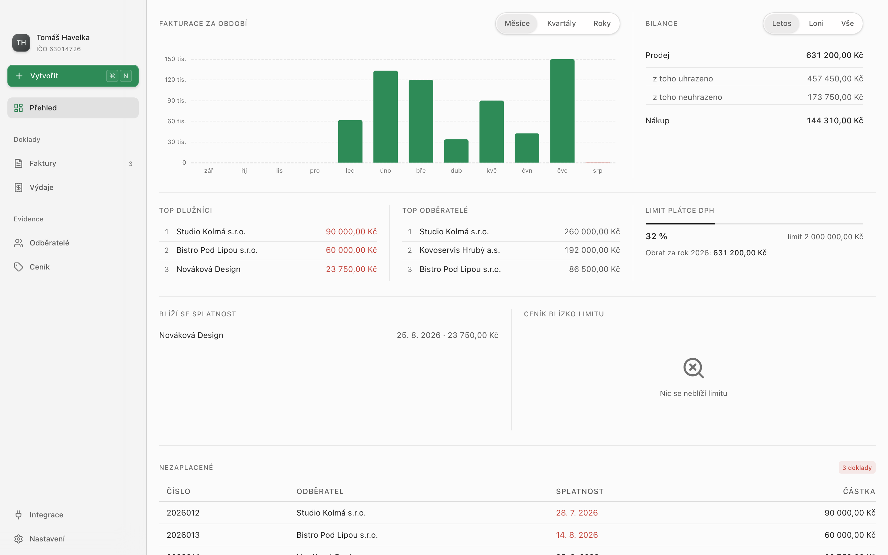
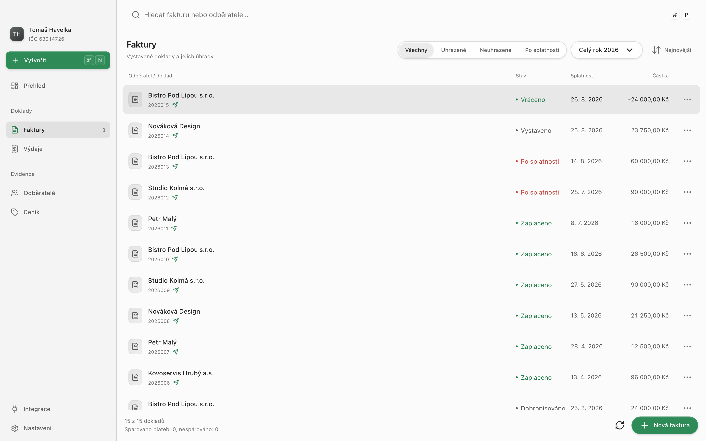
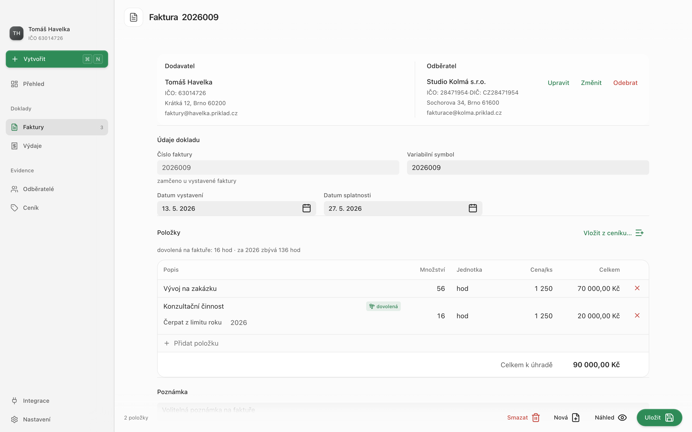
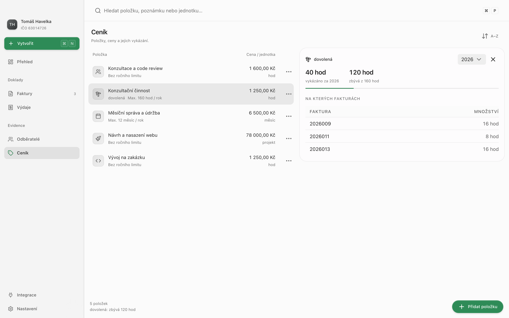
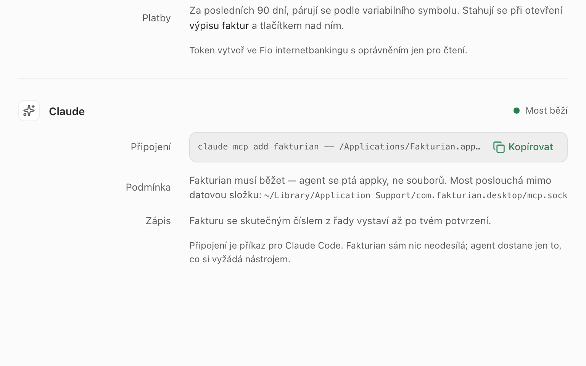

# Fakturian

**Fakturace pro živnostníky na Macu — bez cloudu, bez účtu, data ve tvé složce.**

<picture>
  <source media="(prefers-color-scheme: dark)" srcset="showcase/public/media/shots/hero-prehled.dark.png">
  
</picture>

Desktopová aplikace pro **kompletní provoz živnostníka**: faktury, náklady
a vykázané dny na jednom místě. Všechno běží **lokálně a offline** —
data jsou obyčejné soubory ve složce, kterou si zvolíš („vault"), takže zálohu
a synchronizaci mezi zařízeními řeší to, kam tu složku umístíš (iCloud Drive,
Dropbox, Time Machine, Git, USB). Žádný cloud, žádný účet, žádný lock-in;
proto se nikdy nepoužije SQLite — data musí jít otevřít textovým editorem.
Online jsou jen dvě **volitelné** funkce: dotažení firmy z ARES podle IČO
a synchronizace plateb z banky Fio. Podrobný seznam funkcí je
v [`docs/01-FUNKCE.md`](docs/01-FUNKCE.md).

Technicky je to [Electron](https://www.electronjs.org) s hlavním procesem
v TypeScriptu (`desktop/`) + [Nuxt 4](https://nuxt.com) (Vue 3, TypeScript,
`src/`), PDF se sází přes [Typst](https://typst.app), doklady se exportují do
ISDOC. Licence [FSL-1.1-MIT](LICENSE) — zdroják smí každý číst
a používat, jen ne prodávat jako konkurenční produkt; po dvou letech přechází
každá verze na MIT. Třetí strany přibalené
do appky (Electron, npm balíčky, fonty pro PDF) viz [`NOTICE`](NOTICE) a
[`THIRD-PARTY-NOTICES.txt`](THIRD-PARTY-NOTICES.txt); přehled změn je v
[`CHANGELOG.md`](CHANGELOG.md), ochrana osobních údajů v [`PRIVACY.md`](PRIVACY.md).

## Jak to vypadá

<table>
  <tr>
    <td width="50%">
      <picture>
        <source media="(prefers-color-scheme: dark)" srcset="showcase/public/media/shots/usecase-fakturoid.dark.png">
        
      </picture>
      <p align="center"><b>Faktury</b> — stav úhrady na první pohled, platby z Fio se spárují samy</p>
    </td>
    <td width="50%">
      <picture>
        <source media="(prefers-color-scheme: dark)" srcset="showcase/public/media/shots/usecase-programatory.dark.png">
        
      </picture>
      <p align="center"><b>Faktura</b> — položky z ceníku, PDF/A s ISDOC uvnitř</p>
    </td>
  </tr>
  <tr>
    <td width="50%">
      <picture>
        <source media="(prefers-color-scheme: dark)" srcset="showcase/public/media/shots/usecase-konzultanti.dark.png">
        
      </picture>
      <p align="center"><b>Ceník</b> — roční limit položky hlídá, kolik ještě zbývá vykázat</p>
    </td>
    <td width="50%">
      <picture>
        <source media="(prefers-color-scheme: dark)" srcset="showcase/public/media/shots/usecase-ai-agent.dark.png">
        
      </picture>
      <p align="center"><b>AI agent</b> — Claude se přes MCP zeptá na faktury nebo jednu vystaví</p>
    </td>
  </tr>
</table>

## Co je potřeba mít

| Nástroj   | Verze / poznámka                                                                                      |
| --------- | ----------------------------------------------------------------------------------------------------- |
| **Node**  | `^24.11.0` (viz `engines` v `package.json`) — runtime pro Nuxt, testy i nástroje                      |
| **Bun**   | `1.4.3` (`packageManager`) — jen správce balíčků a spouštěč skriptů, runtime zůstává Node             |
| **macOS** | appka i testy hlavního procesu (klíčenka, Mail.app, Koš) běží jen na macOS; balí se pro Apple Silicon |

Electron si `bun install` stáhne jako balíček `electron`.

Na **testy a kontroly** navíc:

| Nástroj                | K čemu                                          | Instalace              |
| ---------------------- | ----------------------------------------------- | ---------------------- |
| **veraPDF** + **Java** | kontrola PDF/A-3a (`desktop/test/pdfa.test.ts`) | `brew install verapdf` |

Bez veraPDF test PDF/A **spadne nahlas** — to je záměr, tichý skip by dělal
falešnou zelenou. ISDOC se proti XSD validuje přibaleným `xmllint-wasm`, systémový
`xmllint` není potřeba.

Instalace závislostí:

```sh
bun install
```

## Skripty

| Příkaz                    | Co dělá                                                                                             |
| ------------------------- | --------------------------------------------------------------------------------------------------- |
| `bun run dev`             | appka v okně Electronu nad dev serverem Nuxtu s HMR; `bun run dev:web` je jen frontend v prohlížeči |
| `bun run build`           | frontend, hlavní proces a balíček `.app`/DMG přes electron-builder do `.output/release/`            |
| `bun run check`           | **celá kontrolní brána** — pouští se před commitem, viz níž                                         |
| `bun run test`            | vitest nad změněnými soubory; `test:all` celá sada (`unit`, `nuxt`, `desktop`)                      |
| `bun run test:coverage`   | celá sada + pokrytí s prahy 100 % na soubor                                                         |
| `bun run test:desktop`    | jen testy hlavního procesu (`desktop/test/`)                                                        |
| `bun run test:contracts`  | kontrakty frontendu proti skutečným modulům hlavního procesu                                        |
| `bun run mutants:ts`      | mutační testování ze seznamu `mutate` ve `stryker.config.ts`; `--mutate <soubor>` na jeden soubor   |
| `bun run lint` / `format` | oxlint / oxfmt **se zápisem**; `lint:check` a `format:check` jen kontrolují                         |
| `bun run typecheck`       | typy appky, hlavního procesu, nástrojů a skriptů showcase                                           |

Co přesně která brána měří, jaké jsou prahy a jak se čtou mutační reporty, je
v [`docs/10-KVALITA.md`](docs/10-KVALITA.md).

## Dokumentace

| Dokument                                               | Obsah                                                 |
| ------------------------------------------------------ | ----------------------------------------------------- |
| [`docs/01-FUNKCE.md`](docs/01-FUNKCE.md)               | co appka umí, po funkcích, a co je vědomě mimo rozsah |
| [`docs/02-TECHNOLOGIE.md`](docs/02-TECHNOLOGIE.md)     | zvolený stack, hranice s vnějškem, formát dat a proč  |
| [`docs/03-DESIGN.md`](docs/03-DESIGN.md)               | vzhled, rozvržení, zkratky a chování UI               |
| [`docs/05-BACKLOG.md`](docs/05-BACKLOG.md)             | co zbývá udělat — vady, dluhy a nápady po oblastech   |
| [`docs/06-MCP.md`](docs/06-MCP.md)                     | MCP server nad vaultem                                |
| [`docs/07-PRAVO.md`](docs/07-PRAVO.md)                 | právní opora účetních pravidel                        |
| [`docs/09-ISDOC-MODEL.md`](docs/09-ISDOC-MODEL.md)     | model dokladu a ISDOC                                 |
| [`docs/10-KVALITA.md`](docs/10-KVALITA.md)             | model kvality — pravidla testů, brány, prahy, vydání  |
| [`docs/13-ZNAME-OMEZENI.md`](docs/13-ZNAME-OMEZENI.md) | vědomě přijaté kompromisy a co se záměrně nemění      |

Pravidla pro psaní kódu a testů jsou v [`AGENTS.md`](AGENTS.md).
